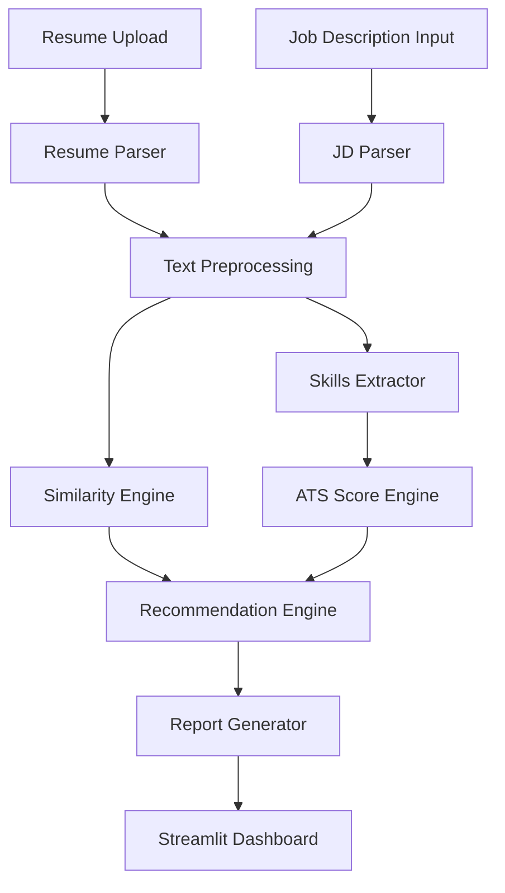

# AI Resume Analyzer

AI Resume Analyzer is an AI-powered Streamlit application that evaluates a candidate's resume against a target job description. It extracts text from PDF and DOCX resumes, identifies relevant skills, measures semantic similarity, estimates ATS compatibility, and generates actionable recommendations to improve resume-job fit.

The project is designed as a clean, modular Python application with separate analyzers for parsing, preprocessing, similarity scoring, ATS evaluation, skills extraction, recommendations, and report generation. It is intended for job seekers, recruiters, career coaches, and developers building practical NLP products.

## Features

- Upload resumes in **PDF** or **DOCX** format
- Paste or load a **job description**
- Extract and normalize resume content
- Compare resume content with the job description
- Compute **resume-job match score**
- Compute **ATS compatibility score**
- Detect **matched skills**
- Detect **missing skills**
- Recommend **high-priority skills to add**
- Highlight **resume strengths**
- Provide **improvement recommendations**
- Visualize skill coverage with **charts**
- Download the final analysis as **PDF**
- Friendly **Streamlit UI** with robust error handling and logging

## Tech Stack

| Layer | Technologies |
| --- | --- |
| Language | Python 3.12 |
| UI | Streamlit |
| NLP | spaCy, Sentence Transformers |
| ML / Scoring | scikit-learn |
| File Parsing | PyPDF2, python-docx |
| Data Handling | pandas |
| Visualization | matplotlib, plotly |
| Config | python-dotenv |
| Testing | pytest |

## Project Structure

```text
AI_Resume_Analyzer/
│
├── app.py
├── requirements.txt
├── README.md
├── LICENSE
├── .gitignore
├── .env.example
│
├── analyzer/
│   ├── __init__.py
│   ├── resume_parser.py
│   ├── jd_parser.py
│   ├── text_preprocessing.py
│   ├── similarity_engine.py
│   ├── ats_score.py
│   ├── skills_extractor.py
│   ├── recommendation.py
│   ├── report_generator.py
│   └── utils.py
│
├── assets/
├── data/
├── reports/
│
└── tests/
    ├── test_parser.py
    ├── test_similarity.py
    └── test_skills.py
```

## How It Works

1. The user uploads a resume in PDF or DOCX format.
2. The application extracts raw text from the document.
3. The text is cleaned and preprocessed for analysis.
4. The job description is parsed and normalized.
5. Skills are extracted from both the resume and the job description.
6. Semantic similarity is computed using sentence embeddings.
7. ATS compatibility is calculated using content completeness and keyword alignment.
8. The system generates insights, charts, and recommendations.
9. A downloadable PDF report is created for the user.

## System Architecture



## Core Modules

### `resume_parser.py`
Handles extraction of text from PDF and DOCX resume files.

### `jd_parser.py`
Processes and structures the job description text.

### `text_preprocessing.py`
Performs cleaning, normalization, token filtering, and lightweight NLP preprocessing.

### `skills_extractor.py`
Identifies technical and professional skills from the resume and job description.

### `similarity_engine.py`
Calculates the semantic similarity score between the resume and the target role.

### `ats_score.py`
Estimates ATS readiness based on formatting-friendly heuristics and keyword alignment.

### `recommendation.py`
Generates personalized recommendations, missing skill insights, and strengths.

### `report_generator.py`
Builds a downloadable PDF report containing the complete analysis.

### `utils.py`
Contains shared helpers for logging, validation, text utilities, and reusable constants.

## Screenshots

Add screenshots of the application UI in this section after running the project locally.

Suggested screenshots:

1. Home page / upload interface
2. Resume analysis dashboard
3. Skill match and missing skills visualization
4. Downloadable report preview

Example asset layout:

```text
assets/
├── screenshots/
│   ├── home.png
│   ├── dashboard.png
│   ├── skills-chart.png
│   └── report-preview.png
```

Example markdown after screenshots are added:

```md


```

## Installation

### 1. Clone the repository

```bash
git clone https://github.com/your-username/AI_Resume_Analyzer.git
cd AI_Resume_Analyzer
```

### 2. Create and activate a virtual environment

**Windows**

```bash
python -m venv .venv
.venv\Scripts\activate
```

**macOS / Linux**

```bash
python3 -m venv .venv
source .venv/bin/activate
```

### 3. Install dependencies

```bash
pip install --upgrade pip
pip install -r requirements.txt
```

### 4. Download the spaCy language model

```bash
python -m spacy download en_core_web_sm
```

### 5. Configure environment variables

Copy the example environment file:

```bash
cp .env.example .env
```

On Windows PowerShell:

```powershell
Copy-Item .env.example .env
```

## Usage

### Run the application

```bash
streamlit run app.py
```

### Typical workflow

1. Launch the Streamlit app.
2. Upload a resume in PDF or DOCX format.
3. Paste the target job description.
4. Review the match score, ATS score, and extracted insights.
5. Inspect matched skills, missing skills, and recommendations.
6. Download the generated PDF report.

## Sample Test Inputs

The project will include:

- A **sample resume** in the `data/` directory
- A **sample job description** in the `data/` directory

These files can be used to test parsing, scoring, and report generation flows end to end.

## Output Insights

The analyzer is expected to produce:

- Overall resume-job **match percentage**
- **ATS compatibility score**
- List of **matched skills**
- List of **missing skills**
- **Recommended skills** to add
- Resume **strengths**
- Resume **improvement suggestions**
- Skill coverage charts and summary metrics

## Engineering Goals

- Clean architecture with strong separation of concerns
- PEP 8 compliant code
- Type hints across modules
- Reusable object-oriented components where appropriate
- Production-style error handling and logging
- Test coverage for critical modules

## Testing

Run the automated tests with:

```bash
pytest
```

The repository will also include a GitHub Actions workflow to automatically run tests on push and pull request events.

## Error Handling and Logging

The application is planned with structured logging and graceful error handling for:

- Unsupported file types
- Corrupted or unreadable documents
- Empty resumes or job descriptions
- NLP model loading failures
- Report generation failures

User-facing messages will remain friendly while detailed diagnostics are logged for debugging.

## Deployment Options

This project can be deployed to:

- Streamlit Community Cloud
- Render
- Railway
- Azure App Service
- AWS Elastic Beanstalk
- Docker-based infrastructure

## Future Enhancements

- Multi-resume batch analysis
- Role-specific skill ontologies
- Resume section scoring
- Keyword density insights
- Cover letter alignment analysis
- LLM-powered rewrite suggestions
- Recruiter dashboard with candidate ranking
- Job description upload via file input
- Export to DOCX in addition to PDF
- Authentication and saved report history

## Contributing

Contributions, suggestions, and improvements are welcome. Please open an issue or submit a pull request with a clear description of the proposed change.

## License

This project is released under the **MIT License**. See the `LICENSE` file for details.

## Author Notes

This repository is structured as a practical portfolio-grade AI + Python full stack project. It demonstrates document parsing, NLP preprocessing, semantic similarity, skills analytics, reporting, and modern developer tooling in a single end-to-end application.